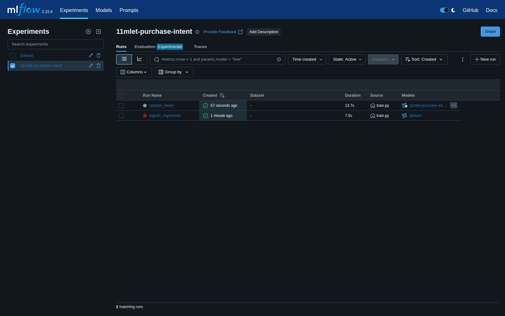
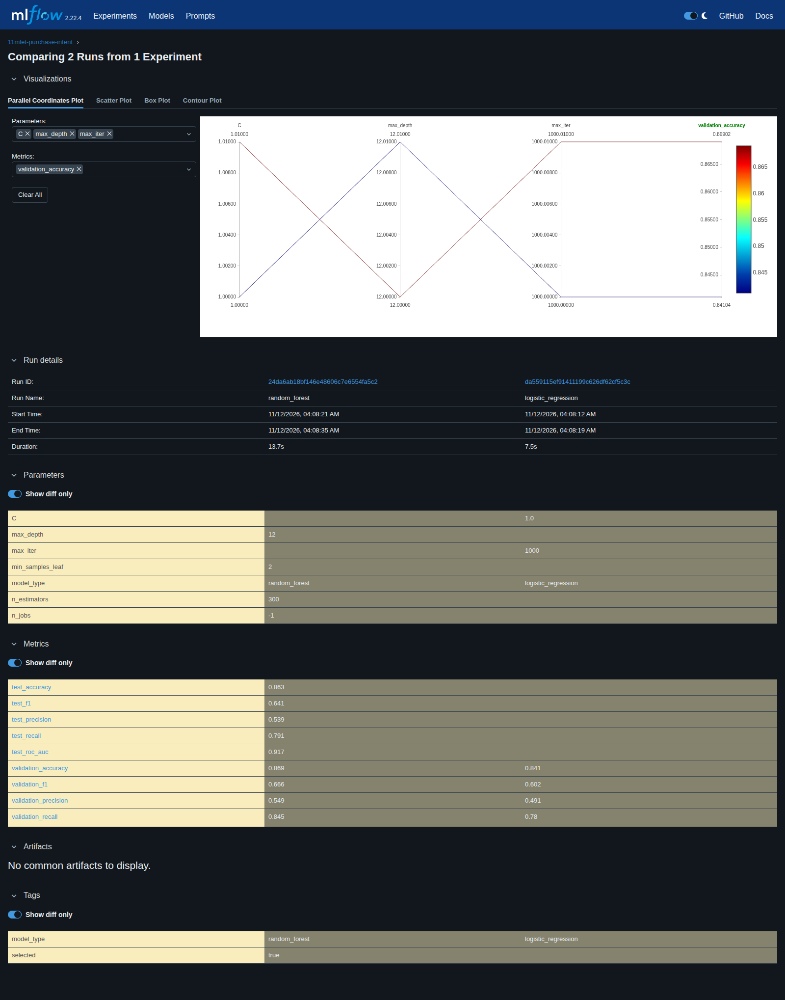
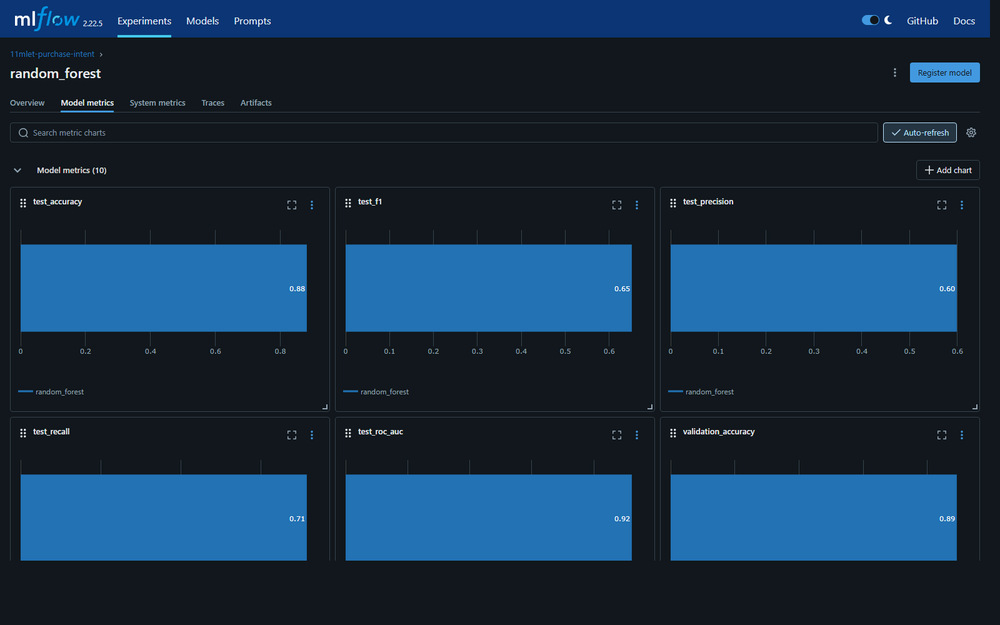
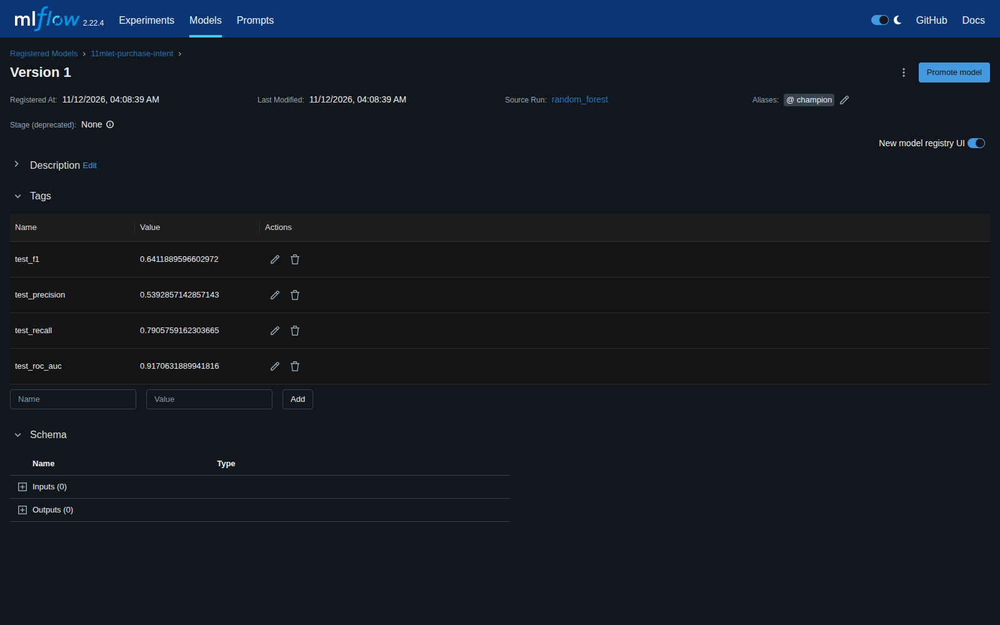

# 11MLET - Tech Challenge - Fase 2

Pipeline de Engenharia de Machine Learning para estimar a **propensão de compra** de uma sessão de navegação em e-commerce. Usamos o dataset *Online Shoppers Purchasing Intention* (UCI), classificadores clássicos do Scikit-Learn, **DVC** para versionar dados e orquestrar o pipeline, **MLflow** para rastrear experimentos e registrar o melhor modelo, **Poetry** para dependências e **Docker** para execução reprodutível.

## Integrantes

| Nome | GitHub |
| --- | --- |
| Carolina Castro | [@carolinamsc](https://github.com/carolinamsc) |

## Vídeo (método STAR)

Link do vídeo: _a preencher_ — roteiro em [docs/VIDEO_STAR_ROTEIRO.md](docs/VIDEO_STAR_ROTEIRO.md).

## Problema e dados

Cada linha é uma sessão; a coluna `Revenue` indica se a sessão terminou em compra (classificação binária, ~15,5% positivos). São 12.330 sessões e 17 atributos (numéricos de navegação + categóricos como mês, tipo de visitante e tráfego). Fonte: Sakar e Kastro, UCI Machine Learning Repository, DOI [10.24432/C5F88Q](https://doi.org/10.24432/C5F88Q), licença CC BY 4.0.

## Arquitetura

```text
download_data ─▶ prepare_data ─▶ train ─▶ evaluate ─▶ register
 (UCI → raw)     (split 60/20/20   (LogReg e     (teste no    (Model Registry,
                  estratificado)    RandomForest, run do       alias champion)
                                    1 run MLflow   melhor)
                                    por modelo)
```

| Estágio DVC | Módulo | Saída |
| --- | --- | --- |
| `download_data` | `scripts/download_dataset.py` | `data/raw/online_shoppers_intention.csv` |
| `prepare_data` | `purchase_intent.data.prepare` | `data/interim/{train,validation,test}.csv` |
| `train` | `purchase_intent.training.train` | `models/purchase_intent.joblib`, `models/best_run.json` |
| `evaluate` | `purchase_intent.evaluation.evaluate` | `reports/metrics.json` (métricas DVC) |
| `register` | `purchase_intent.registry` | `reports/registry.json` |

Decisões principais:

- **Pré-processamento dentro do `Pipeline` do Scikit-Learn** (imputação, `StandardScaler`, `OneHotEncoder`), ajustado só no treino — sem vazamento.
- **Candidatos configuráveis** em `params.yaml` (`model.candidates`); cada um vira um run no MLflow com parâmetros, métricas de validação e o modelo com assinatura.
- **Seleção pelo F1 de validação** (classe positiva minoritária); o teste fica isolado e só é usado no modelo escolhido, com as métricas logadas no mesmo run.
- **Model Registry**: o run vencedor vira uma nova versão de `11mlet-purchase-intent` e recebe o alias `champion`, com as métricas de teste como tags.
- **Reprodutibilidade**: seed única (`experiment.random_seed: 42`) em splits e modelos; dependências travadas em `poetry.lock`; configuração de ambiente em `.env`.

## Pré-requisitos

- Python 3.11 e [Poetry](https://python-poetry.org/) 1.8+
- Docker e Docker Compose
- Git

## Executar localmente

```bash
poetry install
cp .env.example .env            # PowerShell: Copy-Item .env.example .env
docker compose up -d mlflow     # MLflow em http://localhost:5000
poetry run dvc repro            # download → prepare → train → evaluate → register
poetry run dvc metrics show
```

Para rodar sem servidor MLflow, defina no `.env` `CHALLENGE_MLFLOW_TRACKING_URI=sqlite:///mlflow.db` e abra a UI com `poetry run mlflow ui --backend-store-uri sqlite:///mlflow.db`.

## Executar com Docker

```bash
cp .env.example .env
docker compose --profile pipeline up --build --abort-on-container-exit
```

O perfil `pipeline` sobe o MLflow, espera o healthcheck e roda `dvc repro --force` no container. A imagem instala só as dependências de produção via Poetry (multi-stage) e executa como usuário sem privilégios. Dados, modelos, relatórios e cache DVC ficam em volumes nomeados, então funciona igual em Linux, Mac e Windows. Os runs e o modelo `champion` aparecem em http://localhost:5000.

Para ver os resultados gerados no container:

```bash
docker compose --profile pipeline run --rm --no-deps pipeline dvc metrics show
```

O job `docker-pipeline` do CI executa exatamente esse fluxo a cada push.

## Usar o modelo campeão

O script de predição carrega do Model Registry a versão com alias `champion` (`models:/11mlet-purchase-intent@champion`) e adiciona as colunas `purchase_probability` e `purchase_prediction`:

```bash
poetry run python -m purchase_intent.predict data/interim/test.csv reports/predictions.csv
```

## DVC

- `dvc.yaml` define os estágios e `dvc.lock` guarda os hashes de dados, código, parâmetros e saídas.
- `dvc status` mostra o que mudou; `dvc repro` reexecuta só os estágios afetados.
- `dvc dag` exibe o grafo do pipeline; `dvc params diff` e `dvc metrics diff` comparam experimentos.
- O `.gitattributes` força LF e as partições CSV/JSON são gravadas com fim de linha LF, então os hashes de código, dados e métricas são idênticos no Windows, Linux e Docker. A exceção é o binário `models/purchase_intent.joblib`: o pickle muda entre sistemas operacionais (tipos inteiros do NumPy), mas as previsões e métricas não.
- O dataset fica no cache local (`.dvc/cache`). Para compartilhar entre máquinas, configure um remote (`dvc remote add -d storage <url>`) e rode `dvc push` / `dvc pull`. Sem remote, o estágio `download_data` baixa novamente da fonte oficial e o hash em `dvc.lock` garante que é o mesmo arquivo.

## Resultados

| Modelo | Val. F1 | Val. ROC AUC | Teste F1 | Teste ROC AUC | Teste Recall | Teste Accuracy |
| --- | --- | --- | --- | --- | --- | --- |
| Regressão logística | 0.602 | 0.903 | — | — | — | — |
| **Random Forest (champion)** | **0.666** | **0.929** | **0.641** | **0.917** | **0.791** | **0.863** |

Números gerados pelo pipeline Docker do CI com as versões exatas do `poetry.lock`. O teste é calculado só para o modelo escolhido na validação. Accuracy sozinha engana com classes desbalanceadas, por isso a seleção usa F1. Detalhes e limitações em [MODEL_CARD.md](MODEL_CARD.md); valores versionados em `reports/metrics.json`.

```text
$ dvc metrics show
Path                  accuracy    f1       model_type     precision    recall    roc_auc    test_rows

reports/metrics.json  0.86294     0.64119  random_forest  0.53929      0.79058   0.91706    2466
```

### Evidências (MLflow)

Prints gerados pelo job `docker-pipeline` do CI (`scripts/capture_mlflow_screenshots.py`) logo após o pipeline, e publicados no artefato `pipeline-output`.

Runs rastreados no experimento `11mlet-purchase-intent`:



Comparação dos candidatos (parâmetros e métricas de validação/teste):



Métricas do run campeão:



Model Registry com a versão promovida para o alias `champion` e as métricas de teste como tags:



## Estrutura

```text
src/purchase_intent/
  config.py              settings (.env), params.yaml, logging e caminhos
  data/prepare.py        limpeza do alvo e split estratificado
  models/pipeline.py     pré-processamento + fábrica de classificadores
  training/train.py      treino dos candidatos e tracking MLflow
  evaluation/evaluate.py avaliação no teste
  registry.py            Model Registry e alias champion
  predict.py             predição com o modelo champion do Registry
  metrics.py             métricas de classificação
scripts/                 download do dataset, validação do ambiente, regra de 20 linhas
configs/logging.yaml     configuração de logging
tests/                   testes unitários (pytest)
data/ models/ reports/   artefatos versionados pelo DVC
```

## Qualidade

```bash
poetry run ruff check .
poetry run ruff format --check .
poetry run python scripts/check_function_length.py   # funções com no máximo 20 linhas
poetry run pytest
```

O workflow `.github/workflows/ci.yml` roda essas verificações (incluindo um teste de integração com MLflow) e o pipeline completo via Docker Compose a cada push.
